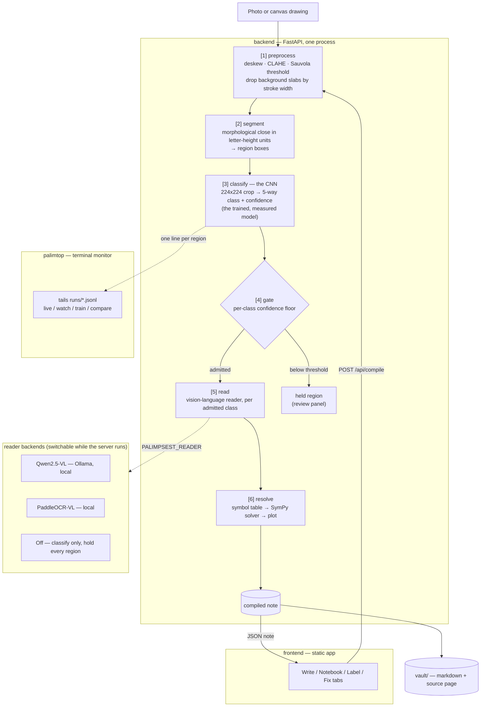
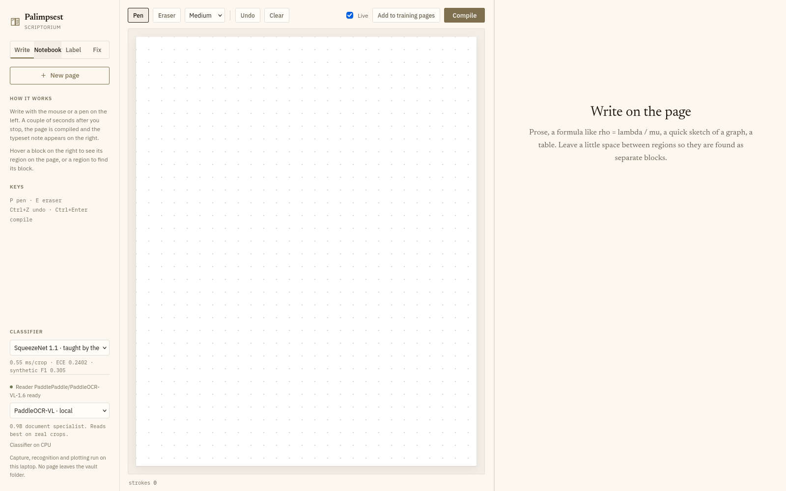
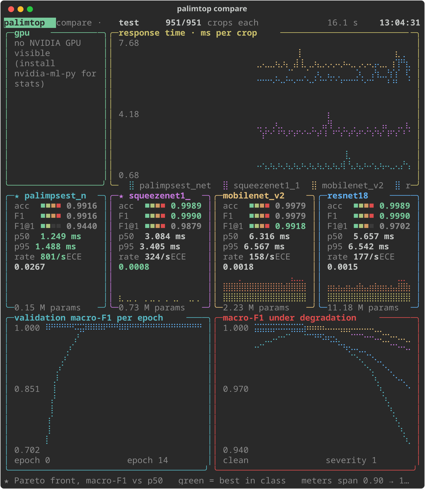

# Palimpsest

Rough handwritten notes in, a typeset engineering notebook out. A photo of a
page is split into regions, each region is classified as `THEORY`, `FORMULA`,
`PLOT_SKETCH`, `DIAGRAM` or `TABLE`, and each class is routed to its own
handler: a local vision-language model reads prose, formulas and tables,
SymPy resolves formulas against values written elsewhere on the page, and a
sketched plot is redrawn exactly from the equation it belongs to. Everything
runs on one laptop — no page image leaves the machine.

UCS668 · Edge AI and Robotics: Data Center Vision.

## Architecture

The pipeline is six stages, each timed and charged against a 2-second
interactive budget so the system can say which stage is the bottleneck
rather than guessing.



**Stage 1, preprocessing**, finds the sheet of paper in the frame, crops to
it, straightens the page, evens out the lighting, and thresholds locally
rather than globally. It then removes **background slabs** by stroke
thickness: handwriting is thin, and a patterned cloth or floor tile the
threshold mistook for ink is a solid slab many times thicker.

**Stage 2, segmentation**, is deliberately classical, with no learned
detector — the project's trained and measured claim is region
*classification*; detection only has to produce crops worth classifying. Ink
is morphologically **closed** with a rectangle sized in multiples of **the
writing's own letter height** (never a fraction of the page — that swung 20x
across real pages in testing), which fuses each region into one blob and
leaves the gaps between regions open.

**Stage 3, classification**, is the model this project trains and measures:
a five-way image classifier over 224×224 greyscale crops, a PyTorch Lightning
module over a switchable backbone (SqueezeNet, MobileNetV2, ResNet18, or a
small custom net).

**Stage 4, the gate**, holds anything below its class's confidence floor
instead of writing a possibly-wrong answer into the note — the floor is set
per class because the classes do not carry equal risk (a garbled sentence is
obvious and easy to fix; a wrong subscript is invisible and silently corrupts
the note).

**Stage 5, reading**, hands each admitted region to a local
vision-language model — the reader is a runtime choice (sidebar dropdown),
not a build-time one, and the choice is reported back so the interface can
say where a page's content went.

**Stage 6, resolution**, pulls values into a symbol table, solves formulas
with SymPy, and redraws sketched plots from the equation they belong to
rather than guessing at a curve.

Full writeup, including the five region classes and the per-class thresholds,
is in [`docs/EXPLAINER.md`](docs/EXPLAINER.md).

## Screenshots

| Frontend — Write view | palimtop — terminal monitor |
|---|---|
| [](docs/screenshots/frontend.png) | [](docs/screenshots/palimtop.png) |
| Draw on the left, the typeset note appears on the right. The sidebar shows the live classifier and reader status. | `palimtop compare` — accuracy, latency and calibration for all four backbones, live. |

## Run it

```bash
ollama serve &                      # if not already running
ollama pull qwen2.5vl:3b            # the page reader, once
./run.sh                            # then open http://localhost:8000
```

`run.sh` starts one process that serves both the API (`/api/...`) and the
frontend (`/`). The classifier runs on CUDA when a GPU is available and on
CPU otherwise.

| | |
|---|---|
| **Write** | Draw on the page with the mouse or a pen; with *Live* on, it compiles two seconds after you stop and the note appears on the right. Hover a block to see its region, or a region to find its block. *Add to training pages* sends the drawing to Label. |
| **Notebook** | *New capture* → photo → compiled note. Held regions show a review panel; click a margin facsimile for the source page with every region outlined. |
| **Label & train** | *Upload pages* → correct the proposed boxes → *Save & next*. *Train* fine-tunes on everything labelled. |
| **Classifier** | Sidebar dropdown. `synthetic` checkpoints come from `runs/`, `your pages` from `runs_real/` after a fine-tune. |
| **Reader** | Sidebar dropdown, switchable while the server runs: Qwen2.5-VL, PaddleOCR-VL, or off. The line under it says where pages go, and changes with the choice. |

**Everything here runs on this laptop.** Capture, recognition and plotting
never leave the machine; no page image is uploaded anywhere.

Other entry points, all from `backend/`:

```bash
.venv/bin/python -m app.tui.palimtop compare        # live terminal monitor, all four backbones
.venv/bin/python -m app.finetune --backbone squeezenet1_1 --epochs 8
.venv/bin/python -m pytest                          # the test suite
PALIMPSEST_READER=paddle ./run.sh                   # PaddleOCR-VL reader instead of Qwen (ollama stop first)
```

## Labelling your own pages

The classifier was trained on synthetic pages and scores well there, which
says nothing about your handwriting. Labelling real pages and fine-tuning is
how it learns your notes, and the Train panel reports macro-F1 on your own
held-out pages **before and after**, which is the honest number.

**Photographing.** Flat page, even light, the page filling most of the frame.
Each upload is deskewed and resized to 1600 px on the long side, and boxes
are drawn on that stored version.

**Editor keys.**

| Action | How |
|---|---|
| New box | drag on empty paper (uses the selected class) |
| Select, move | click a box, drag it |
| Resize | drag a corner of the selected box |
| Set class | `1` Theory · `2` Formula · `3` Plot · `4` Diagram · `5` Table |
| Delete box | `Delete` or `Backspace` |
| Save | `Ctrl+S`; `Enter` saves and opens the next unlabelled page |

Dashed boxes are the machine's proposals, with its guess and confidence. They
become solid once you touch them or save.

**What to aim for.** Pages are assigned to train, val or test by a hash of
their id, about 70/15/15, so labels on a test page are never trained on. The
counts table turns orange for any class with fewer than 10 training regions.
Plots, diagrams and tables are naturally rarer than prose, so write some
pages that are deliberately mostly those. A useful first fine-tune needs a
few dozen pages; Train refuses with fewer than 3 train and 1 val page.

**Training.** One click. It always starts from the synthetic weights rather
than the previous fine-tune, so a bad batch of labels cannot compound. When
it finishes, pick `… · your pages` in the Classifier dropdown.

## Repo layout

```
backend/app/
  pipeline/   preprocess, segment, gate, compile, budget
  models/     zoo, classifier (Lightning), profiler
  data/       synthetic generator, ink, augmentation, real-page store
  routers/    symbol table, solver, plot range and sampling
  vlm/        Qwen2.5-VL (Ollama) and PaddleOCR-VL readers
  tui/        palimtop terminal monitor
  main.py     FastAPI
frontend/     static app, KaTeX vendored
docs/         architecture explainer, data provenance, code audit
```

See [`docs/EXPLAINER.md`](docs/EXPLAINER.md) for the full architecture and
the classifier's design, [`docs/PROVENANCE.md`](docs/PROVENANCE.md) for
where the data came from, and [`docs/AUDIT.md`](docs/AUDIT.md) for the code
audit.
